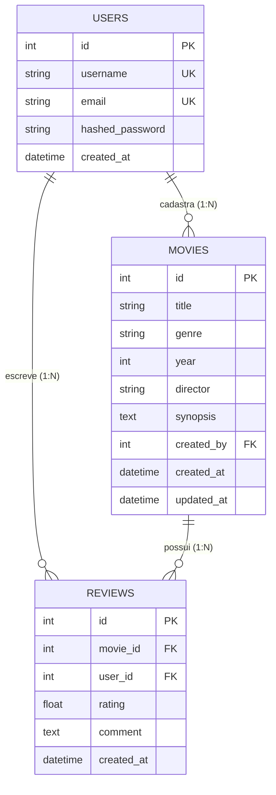

# RELATÓRIO TÉCNICO DE ATIVIDADE PRÁTICA
## Disciplina: Arquitetura e Desenvolvimento de APIs
**Centro Universitário Internacional Uninter**

---

**Título do Projeto:** CineTrack API — Catálogo e Avaliação de Obras Cinematográficas  
**Data:** Outubro de 2026  


---

## 1. Introdução

### 1.1 Contextualização do Problema
Com o crescimento expressivo do consumo de mídia audiovisual e a proliferação de plataformas de streaming, cinéfilos e espectadores casuais enfrentam dificuldades para manter um registro unificado e organizado das obras cinematográficas a que assistem, bem como de suas percepções críticas, notas e comentários. As ferramentas proprietárias existentes frequentemente impõem ecossistemas fechados, com interfaces sobrecarregadas e sem interfaces de programação abertas para integração com sistemas pessoais.

### 1.2 Objetivo da Solução
O objetivo deste trabalho é projetar, desenvolver, documentar e demonstrar a **CineTrack API**, uma API Web própria, aderente ao estilo arquitetural REST/RESTful, voltada ao gerenciamento de um catálogo pessoal de filmes e resenhas críticas. A API viabiliza operações completas de criação, leitura, atualização e exclusão (CRUD), persistência relacional, validação de entradas, tratamento padronizado de falhas, proteção de endpoints via JSON Web Tokens (JWT) e controle de compartilhamento de recursos entre origens (CORS).

### 1.3 Público-Alvo e Cenário de Uso
A CineTrack API atende a cinéfilos, administradores de catálogos culturais e desenvolvedores que buscam um backend limpo para alimentar aplicações web, mobile ou scripts de automação para rastreamento de filmes assistidos e compartilhamento de avaliações.

---

## 2. Tecnologias Utilizadas

A pilha de tecnologias adotada foi selecionada com foco em produtividade, segurança, tipagem estática e conformidade com as boas práticas modernas de engenharia de software:

| Componente | Tecnologia Adotada | Versão |
|---|---|---|
| **Linguagem de Programação** | Python | 3.12 |
| **Framework Web** | FastAPI | 0.104.1 |
| **Servidor ASGI** | Uvicorn | 0.24.0 |
| **Banco de Dados** | SQLite | 3.x |
| **ORM (Mapeamento Objeto-Relacional)** | SQLAlchemy | 2.0.23 |
| **Validação e Serialização** | Pydantic | 2.5.2 |
| **Criptografia / Hashing de Senhas** | Passlib + BCrypt | 1.7.4 / 4.0.1 |
| **Autenticação e Tokens** | Python-JOSE (JWT) | 3.3.0 |
| **Documentação Interativa** | OpenAPI / Swagger UI / ReDoc | Integrados nativamente |
| **Testes Automatizados** | Starlette TestClient / HTTPX | 0.27.2 |

---

## 3. Justificativa das Escolhas Tecnológicas

1. **Python & FastAPI**:
   - O FastAPI foi escolhido por ser um framework moderno, de altíssimo desempenho (baseado em Starlette e AnyIO) e fortemente tipado via Python Type Hints.
   - Ele gera nativamente a especificação OpenAPI (Swagger UI em `/docs` e ReDoc em `/redoc`), eliminando discrepâncias entre código e documentação.
   - A injeção de dependências (`Depends`) do FastAPI simplifica o gerenciamento de sessões do banco de dados e a cadeia de validação de autenticação/autorização.

2. **SQLAlchemy 2.0 (ORM)**:
   - É o padrão da indústria para persistência em Python, fornecendo o padrão *Data Mapper* / *Declarative Base*, abstraindo queries SQL nativas e permitindo controle transacional rigoroso com rollback automático em falhas.
   - O suporte a relacionamentos (`relationship`) gerencia chaves estrangeiras e integridade referencial com políticas em cascata (`cascade="all, delete-orphan"`).

3. **SQLite**:
   - Escolhido por ser um banco de dados relacional embarcado (serverless), mantendo persistência real em arquivo físico (`cinetrack.db`) entre execuções.
   - Essa decisão elimina a necessidade de o professor instalar ou configurar instâncias de servidores externos (como PostgreSQL ou MySQL), viabilizando reprodutibilidade imediata com zero atrito de configuração.

4. **JSON Web Tokens (JWT) com BCrypt**:
   - O JWT é um padrão aberto (RFC 7519) para representação segura de reivindicações entre duas partes, sendo inerentemente *stateless*, o que se alinha com o princípio fundamental de ausência de estado do REST.
   - Para segurança de credenciais, a biblioteca BCrypt aplica fator de custo (*work factor*) e salgamento automático (*salt*), prevenindo ataques de dicionário e *rainbow tables*.

---

## 4. Arquitetura da API

A aplicação segue uma arquitetura em camadas bem definida, garantindo desacoplamento, separação de responsabilidades e manutenibilidade:

```
cinetrack-api/
├── app/
│   ├── auth/           # Camada de segurança (JWT, BCrypt, dependência get_current_user)
│   ├── models/         # Camada de domínio e persistência ORM (SQLAlchemy Base)
│   ├── schemas/        # Camada de transferência de dados e validação (DTOs Pydantic)
│   ├── routers/        # Camada de controle/endpoints (Controllers HTTP)
│   ├── config.py       # Configurações do ambiente (Environment Variables)
│   ├── database.py     # Engine de persistência e gerenciamento de sessões
│   └── main.py         # Ponto de entrada, middlewares (CORS) e handlers globais
├── seed.py             # Script de povoamento inicial para avaliação
├── tests_and_evidence.py # Bateria de testes automatizados e evidências
├── requirements.txt    # Manifesto de dependências do projeto
├── README.md           # Instruções de reprodução e guia de uso
└── .env.example        # Modelo de variáveis de ambiente sem dados sensíveis
```

### Recursos da API
1. **`/auth`**: Gerenciamento de credenciais, registro de contas e emissão de tokens de acesso.
2. **`/movies`**: Recurso principal da aplicação, sobre o qual incide o CRUD completo, busca paginada e filtros contextuais.
3. **`/movies/{movie_id}/reviews`**: Recurso subordinado/relacionado que permite a usuários avaliarem títulos do catálogo.

---

## 5. Banco de Dados e Mapeamento Objeto-Relacional (ORM)

### 5.1 Funcionamento do ORM
A aplicação utiliza a abordagem declarativa moderna do SQLAlchemy 2.0 (`DeclarativeBase`). Cada classe Python herda de `Base` e mapeia diretamente uma tabela relacional. Os atributos de classe representam colunas do banco com seus respectivos tipos primitivos, restrições (`nullable`, `unique`, `index`) e chaves primárias e estrangeiras.

O ciclo de vida das transações é governado pela função geradora `get_db()`, injetada nos endpoints via `Depends(get_db)`. Essa função instancia uma sessão (`SessionLocal`), executa a operação e garante o fechamento (`db.close()`) no bloco `finally`, prevenindo vazamentos de conexões.

### 5.2 Modelagem de Entidades e Relacionamentos



- **User**: Armazena identidade, e-mail único e hash criptográfico da senha. Possui relacionamento 1:N com `Movie` e `Review`.
- **Movie**: Representa a obra fílmica. Possui chave estrangeira `created_by` referenciando `users.id`. A exclusão de um filme dispara exclusão em cascata de suas avaliações associadas (`cascade="all, delete-orphan"`).
- **Review**: Representa a avaliação crítica. Estabelece chave composta lógica garantindo que um usuário só avalie uma vez cada filme específico.

---

## 6. Endpoints e Protocolo HTTP

A API respeita rigorosamente a semântica dos verbos HTTP, convenções de nomenclatura de URLs no plural e uso correto de códigos de status.

### Tabela Obrigatória de Endpoints da Aplicação

| Método | Endpoint | Finalidade | Entrada principal | Respostas esperadas |
|---|---|---|---|---|
| **GET** | `/movies` | Listar coleção de filmes | Query params: `genre`, `year`, `page`, `limit` (opcionais) | `200 OK` |
| **GET** | `/movies/{movie_id}` | Consultar filme individual | Path param: `movie_id` (inteiro) | `200 OK` / `404 Not Found` |
| **POST** | `/movies` | Criar novo filme (🔒 Requer JWT) | Header `Authorization` + JSON no corpo (`title`, `genre`, `year`, `director`, `synopsis`) | `201 Created` / `400 Bad Request` / `401 Unauthorized` / `422 Unprocessable` |
| **PUT** | `/movies/{movie_id}` | Atualizar filme existente (🔒 Requer JWT + ser o autor) | Path param `movie_id` + JSON completo de substituição | `200 OK` / `400 Bad Request` / `401 Unauthorized` / `403 Forbidden` / `404 Not Found` |
| **DELETE** | `/movies/{movie_id}` | Excluir filme (🔒 Requer JWT + ser o autor) | Path param `movie_id` (inteiro) + Header `Authorization` | `204 No Content` / `401 Unauthorized` / `403 Forbidden` / `404 Not Found` |

### Demais Endpoints Implementados

| Método | Endpoint | Finalidade | Entrada principal | Respostas esperadas |
|---|---|---|---|---|
| **POST** | `/auth/register` | Registrar nova conta | JSON (`username`, `email`, `password`) | `201 Created` / `409 Conflict` / `422 Unprocessable` |
| **POST** | `/auth/login` | Autenticar usuário | JSON (`username`, `password`) | `200 OK` (token retornado) / `401 Unauthorized` |
| **GET** | `/movies/{movie_id}/reviews` | Listar avaliações de um filme | Path param `movie_id` | `200 OK` / `404 Not Found` |
| **POST** | `/movies/{movie_id}/reviews` | Avaliar filme (🔒 Requer JWT) | Path param `movie_id` + JSON (`rating`, `comment`) | `201 Created` / `401 Unauthorized` / `404 Not Found` / `409 Conflict` |

### Justificativa da Escolha do Método PUT
Optou-se pela implementação do método **`PUT`** (em detrimento de `PATCH`) para a atualização do recurso principal `Movie`. A semântica formal do HTTP define `PUT` como uma substituição integral do estado do recurso no URI especificado. No contexto do catálogo de filmes:
1. O recurso possui um número conciso e coeso de atributos (`title`, `genre`, `year`, `director`, `synopsis`).
2. Exigir o payload completo na requisição de atualização garante que o estado da obra permaneça integral, evitando discrepâncias ou inconsistências decorrentes de atualizações parciais desincronizadas.
3. O cliente possui clareza sobre o estado final resultante da operação no servidor.

---

## 7. Validação de Dados e Tratamento de Erros

### 7.1 Estratégia de Validação com Pydantic
A camada de validação intercepta todas as requisições antes que atinjam a lógica de negócio ou o banco de dados:
- **Tipagem e limites numéricos**: O campo `year` é validado com restrições `ge=1888` (ano do primeiro filme da história) e `le=2026` (ano corrente).
- **Validação de e-mail**: Uso de `EmailStr` com o pacote `email-validator` para checagem sintática rigorosa.
- **Tamanho de strings**: Nomes de usuários (mínimo 3, máximo 50 caracteres) e senhas (mínimo 6 caracteres).
- **Regras de domínio customizadas**: O campo `genre` é validado contra uma lista canônica de gêneros cinematográficos aceitos (`drama`, `ação`, `ficção científica`, etc.). Se um gênero não reconhecido for submetido, a API rejeita com `400 Bad Request` detalhando as opções válidas.

### 7.2 Tratamento de Falhas e Códigos HTTP Padronizados
A aplicação implementa respostas coerentes em formato JSON padronizado com a chave `{"detail": "..."}`:
- **`200 OK`**: Operações de consulta bem-sucedidas.
- **`201 Created`**: Criação de recursos com retorno da entidade gerada.
- **`204 No Content`**: Exclusão bem-sucedida, sem necessidade de corpo de resposta.
- **`400 Bad Request`**: Dados em formato tecnicamente legível, mas que violam regras lógicas de negócio.
- **`401 Unauthorized`**: Ausência de cabeçalho `Authorization`, token inválido ou expirado, ou credenciais incorretas no login.
- **`403 Forbidden`**: Usuário devidamente autenticado, mas sem privilégios para atuar sobre o recurso (exemplo: usuário B tentando alterar ou deletar filme cadastrado pelo usuário A).
- **`404 Not Found`**: Identificador inexistente na base de dados.
- **`409 Conflict`**: Violação de unicidade (tentativa de duplicar username ou e-mail já existente).
- **`422 Unprocessable Entity`**: Payload que não respeita o contrato do schema Pydantic.
- **`500 Internal Server Error`**: Interceptador global via `@app.exception_handler(Exception)` que esconde detalhes de implementação e impede vazamento de stacktraces sensíveis ao cliente.

---

## 8. Segurança, Autenticação e CORS

### 8.1 Mecanismo de Autenticação JWT
A segurança da CineTrack API adota a especificação OAuth2 com Bearer Token JWT:
1. No login (`POST /auth/login`), as credenciais são confrontadas contra o hash BCrypt salvo no banco.
2. Havendo correspondência, é assinado digitalmente um token com algoritmo `HS256`, contendo no payload:
   - `sub`: ID do usuário autenticado (string formatada);
   - `exp`: Timestamp Unix de expiração (30 minutos após a emissão).
3. A dependência `get_current_user` valida o token a cada requisição a endpoints protegidos, extrai o usuário correspondente e o injeta diretamente no controller.
4. Caso o token seja forjado, corrompido ou expire, a requisição é barrada imediatamente com `401 Unauthorized`.

### 8.2 Política de CORS (Cross-Origin Resource Sharing)
O CORS é um mecanismo de segurança implementado pelos navegadores que bloqueia requisições assíncronas (como `fetch` ou `XMLHttpRequest`) originadas em domínios, protocolos ou portas distintos daquele onde a API reside.

Na CineTrack API, o middleware `CORSMiddleware` foi configurado da seguinte forma:

```python
app.add_middleware(
    CORSMiddleware,
    allow_origins=["*"],       # Permite requisições de qualquer origem
    allow_credentials=True,
    allow_methods=["*"],       # Permite GET, POST, PUT, DELETE, OPTIONS, etc.
    allow_headers=["*"],       # Permite Authorization, Content-Type, etc.
)
```

**Justificativa Técnica da Configuração:**  
A API foi desenvolvida como um serviço backend desacoplado, concebido para ser consumido e avaliado por diversas interfaces clientes simultâneas: documentação interativa embutida (Swagger UI/ReDoc), clientes HTTP locais (Postman, Insomnia, scripts Python/cURL) e eventuais frontends hospedados em portas distintas durante a correção acadêmica (`http://localhost:3000`, `http://127.0.0.1:5173`, etc.). A liberação de origens amplas (`"*"`) previne bloqueios indesejados durante a avaliação. Em um ambiente produtivo real com frontend corporativo definido, a lista `allow_origins` seria restrita estritamente aos FQDNs autorizados (ex: `["https://cinetrack.meudominio.com"]`).

---

## 9. Testes e Evidências de Funcionamento

Para comprovar cabalmente o atendimento a todos os requisitos do roteiro, foi desenvolvida a suíte de testes automatizados `tests_and_evidence.py`, utilizando o `TestClient` do FastAPI sobre uma instância de banco de dados limpa.

### Resumo da Execução da Suíte (23 Testes)

Todos os 23 testes executados obtiveram status **PASSOU (100% de sucesso)**:

```text
Iniciando testes da API...
[OK] Teste 1: Registro de usuario valido (Alice) | POST /auth/register -> 201
[OK] Teste 2: Conflito de username duplicado | POST /auth/register -> 409
[OK] Teste 3: Registro de segundo usuario (Bob) | POST /auth/register -> 201
[OK] Teste 4: Login com sucesso e geracao de JWT | POST /auth/login -> 200
[OK] Teste 5: Login de Bob | POST /auth/login -> 200
[OK] Teste 6: Login com senha incorreta | POST /auth/login -> 401
[OK] Teste 7: Tentativa de criar filme sem autenticacao | POST /movies -> 401
[OK] Teste 8: Criacao de filme com usuario autenticado | POST /movies -> 201
[OK] Teste 9: Criacao de segundo filme | POST /movies -> 201
[OK] Teste 10: Validacao de genero invalido | POST /movies -> 400
[OK] Teste 11: Validacao Pydantic de ano fora do limite | POST /movies -> 422
[OK] Teste 12: Listagem de filmes | GET /movies -> 200
[OK] Teste 13: Consulta de filme por ID | GET /movies/1 -> 200
[OK] Teste 14: Filtro de filmes por genero | GET /movies?genre=drama -> 200
[OK] Teste 15: Consulta de filme inexistente | GET /movies/9999 -> 404
[OK] Teste 16: Bloqueio de edicao por outro usuario | PUT /movies/1 -> 403
[OK] Teste 17: Atualizacao de filme pelo criador | PUT /movies/1 -> 200
[OK] Teste 18: Criacao de avaliacao para o filme | POST /movies/1/reviews -> 201
[OK] Teste 19: Listagem de avaliacoes do filme | GET /movies/1/reviews -> 200
[OK] Teste 20: Bloqueio de exclusao por outro usuario | DELETE /movies/2 -> 403
[OK] Teste 21: Exclusao de filme pelo criador | DELETE /movies/2 -> 204
[OK] Teste 22: Verificacao de filme excluido | GET /movies/2 -> 404
[OK] Teste 23: Validacao do header CORS | GET / -> 200

Todos os 23 testes executados com sucesso.
```

---

## 10. Execução do Projeto

O avaliador pode reproduzir fielmente a aplicação em sua máquina local seguindo o passo a passo:

### 10.1 Pré-requisitos
- Python 3.10 ou superior.

### 10.2 Passos de Instalação e Execução
1. **Clonar o repositório:**
   ```bash
   git clone <URL_DO_REPOSITORIO>
   cd Trabalho
   ```

2. **Criar e ativar o ambiente virtual:**
   ```bash
   # No Windows:
   python -m venv venv
   .\venv\Scripts\activate

   # No Linux/macOS:
   python3 -m venv venv
   source venv/bin/activate
   ```

3. **Instalar as dependências:**
   ```bash
   pip install -r requirements.txt
   ```

4. **Configurar variáveis de ambiente:**
   ```bash
   cp .env.example .env
   ```

5. **(Opcional) Popular o banco com dados de teste:**
   ```bash
   python seed.py
   ```

6. **Iniciar o servidor da API:**
   ```bash
   uvicorn app.main:app --reload
   ```

7. **Acessar a documentação interativa Swagger:**
   - Abra o navegador no endereço: [http://127.0.0.1:8000/docs](http://127.0.0.1:8000/docs)

8. **Executar a suíte de testes automatizados:**
   ```bash
   python tests_and_evidence.py
   ```

---

## 11. Repositório

- **URL do Repositório Remoto:** `[Inserir aqui o link do seu repositório no GitHub ou GitLab]`
- O repositório contém todo o código-fonte, histórico de commits, documentação, arquivo `.env.example`, suíte de testes e arquivos de suporte.

---

## 12. Considerações Finais

### 12.1 Decisões Tomadas
- A escolha pelo FastAPI com SQLAlchemy 2.0 e SQLite provou-se altamente eficiente: garantiu tipagem estática ponta a ponta, documentação viva instantânea sem overhead e execução sem atrito para o avaliador.
- A restrição de que apenas o usuário criador de um filme possa alterá-lo ou excluí-lo (`403 Forbidden`) agregou robustez ao domínio da aplicação, demonstrando controle de acesso granular além da simples autenticação.

### 12.2 Dificuldades Encontradas e Soluções
- **Incompatibilidade entre Passlib e versões recentes do BCrypt (5.x) em Python 3.12**: Durante a execução dos testes iniciais, o Passlib disparou exceção na checagem interna de tamanho de senha devido a mudanças de versão no BCrypt. A dificuldade foi solucionada fixando a dependência `bcrypt==4.0.1` no manifesto `requirements.txt`, garantindo estabilidade multiplataforma.
- **Tipagem estática da reivindicação `sub` do JWT**: A especificação RFC 7519 e a biblioteca `python-jose` exigem estritamente que a claim `sub` seja uma cadeia de caracteres (`string`). O ajuste foi realizado convertendo `str(user.id)` na codificação e convertendo de volta para inteiro na resolução da sessão.

### 12.3 Limitações e Possíveis Melhorias
- **Upload de Imagens / Pôsteres**: Futuras versões podem implementar upload de arquivos de imagem dos pôsteres dos filmes utilizando armazenamento em nuvem (ex: AWS S3 ou Cloudinary).
- **Consumo de API Externa**: A arquitetura foi preparada para que uma rota como `/movies/search-external` possa consultar metadados da TMDb (The Movie Database) ou OMDb API, enriquecendo os registros do catálogo antes da persistência.
- **Refresh Tokens**: Introduzir tokens de atualização com longa expiração para renovação silenciosa de tokens de acesso de curta duração.
